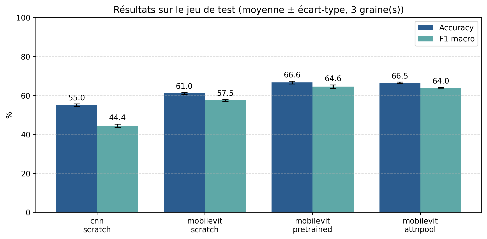
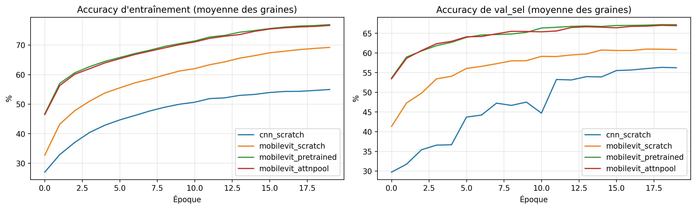
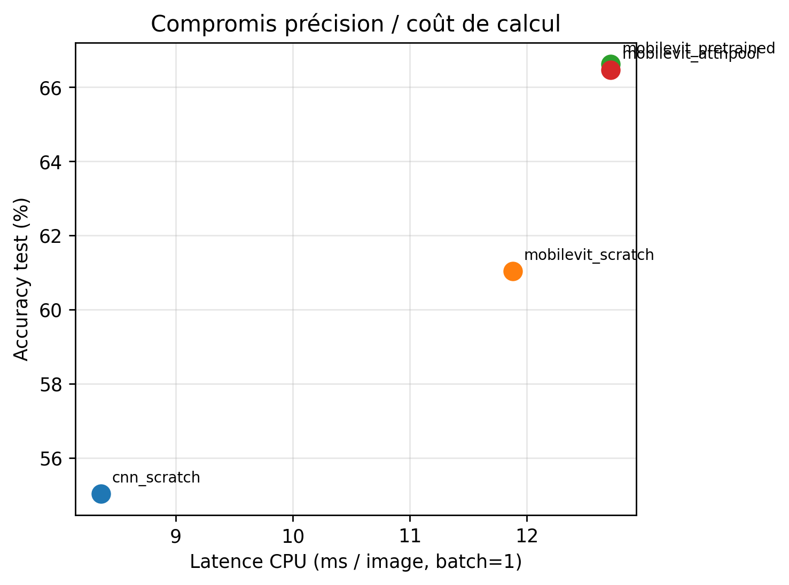
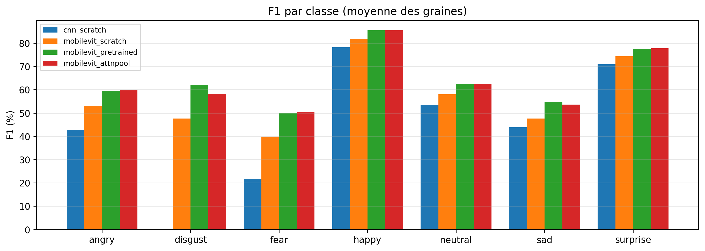
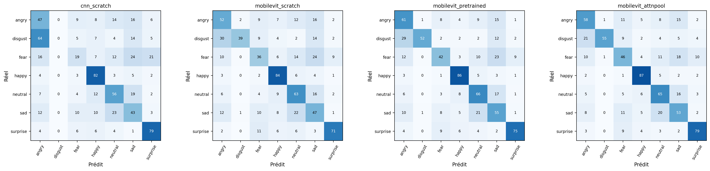
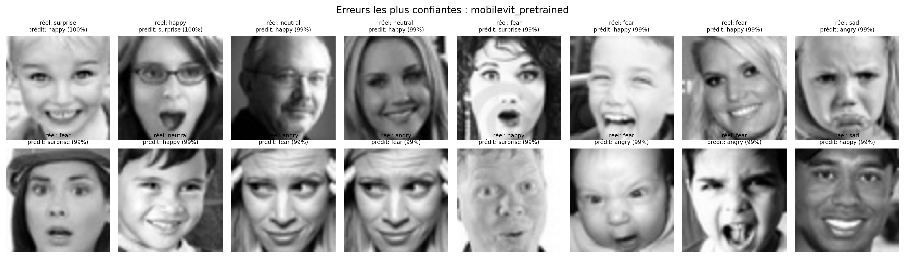
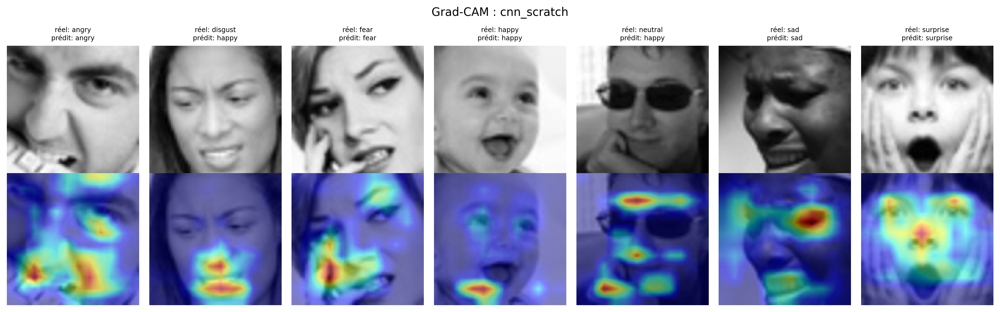
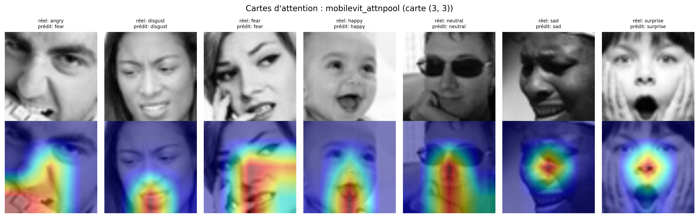

# Reconnaissance des émotions faciales sur FER-2013 : CNN vs Vision Transformer léger, pooling attentionnel et analyse d'erreurs

Projet réalisé en binôme autour de la classification des expressions faciales sur le jeu de données **FER-2013** (7 émotions, images en niveaux de gris 48×48, créé par Pierre-Luc Carrier et Aaron Courville). Le projet compare une approche convolutionnelle (inspirée de Modi et al.) à une approche basée sur un *Vision Transformer* léger (MobileViT) et sur un **pooling attentionnel** (inspiré de Xue et al.).

Le dépôt contient deux parties :

1. **Partie 1 : modèles de base** (`CNN_Modi_et_al.ipynb`, `vision_transformer_et_comparaison.ipynb`) : un premier CNN, un premier MobileViT, une comparaison directe et un test temps réel via webcam.
2. **Partie 2 : expériences contrôlées sur 20 époques** (`experiences_emotions_FER2013_20.ipynb`, résultats dans `results/results_epoch20/`) : protocole rigoureux avec jeu de test indépendant, 3 graines aléatoires, ablations (préentraînement, pooling attentionnel), mesure d'efficacité et analyse d'erreurs.

## Auteurs (Binôme)

- **RANDRIANJAFY Voahanginiaina Roberte**
- **RAJAOVELONA Hidekela Fanaperantsoa**

---

## Structure du dépôt

```
FacEmoRec/
├── CNN_Modi_et_al.ipynb                      # Partie 1 : CNN
├── vision_transformer_et_comparaison.ipynb   # Partie 1 : MobileViT, comparaison, webcam
├── experiences_emotions_FER2013_20.ipynb     # Partie 2 : expériences contrôlées (20 époques)
├── dataset/                                  # Données FER-2013 (train/ et val/ ou test/)
├── models/                                   # Poids sauvegardés de la partie 1 (.pth)
├── ref/                                      # Articles de référence (Modi et al., Xue et al.)
├── results/
│   └── results_epoch20/                      # Résultats de la partie 2 (20 époques)
│       ├── ckpt/                             # Meilleurs poids de chaque modèle et de chaque graine (.pth)
│       ├── <modele>_seed<k>.json             # Métriques, historique, prédictions de chaque exécution
│       ├── summary.csv                       # Tableau agrégé (moyenne ± écart-type)
│       ├── efficiency.csv                    # Paramètres et latence (CPU / GPU)
│       └── *.png                             # Figures (voir section Résultats)
└── README.md
```

---

## Les objectifs et la méthode utilisée

### Objectifs

- **Partie 1** : comparer un CNN local (48×48) et un MobileViT préentraîné sur FER-2013, évaluer l'inférence en temps réel avec la webcam.
- **Partie 2** : répondre proprement à la question *« le Transformer est-il meilleur que le CNN, et pourquoi ? »* en séparant trois effets :
  1. l'**architecture** (CNN vs MobileViT, tous deux entraînés depuis zéro) ;
  2. le **préentraînement ImageNet** (MobileViT depuis zéro vs préentraîné) ;
  3. la **tête de pooling attentionnel** (pooling moyen standard vs pooling attentionnel).
- Analyser les erreurs (matrices de confusion, F1 par classe, exemples mal classés, Grad-CAM et cartes d'attention) et mesurer le coût de calcul.

### Méthode : Partie 1

- **CNN (`CNN_Modi_et_al.ipynb`)** : images en `48×48`, entraînement avec `AdamW` et `CrossEntropyLoss`, meilleurs poids sauvegardés (`best_cnn_emotion.pth`), figures exportées (`resultats_cnn_emotion.png`).
- **MobileViT (`vision_transformer_et_comparaison.ipynb`)** : MobileViT-XXS préentraîné (`timm`), *fine-tuning* sur Google Colab, poids dans `best_vit_emotion.pth`, figures `resultats_vit_emotion.png` et `comparaison_cnn_vs_vit.png`.
- **Inférence webcam** : détection des visages avec `cv2.CascadeClassifier` (`opencv-python<5`), puis prédiction de l'émotion en temps réel.

### Méthode : Partie 2 (`experiences_emotions_FER2013_20.ipynb`)

**Protocole d'évaluation.**
- Le jeu `val` de FER-2013 (7 178 images, correspondant à PublicTest + PrivateTest) est coupé en deux moitiés **stratifiées** (`random_state=42`) :
  - `val_sel` (3 589 images) : sert uniquement à **choisir la meilleure époque** ;
  - `test` (3 589 images) : sert uniquement au **résultat final**, évalué **une seule fois** par entraînement.
- Chaque expérience est répétée avec **3 graines** (0, 1, 2) ; les résultats sont donnés en **moyenne ± écart-type**.

**Quatre modèles, mêmes conditions d'entraînement.**

| Modèle | Description | Préentraîné | Learning rate |
|---|---|---|---|
| `cnn_scratch` | CNN type Modi et al. (4 blocs Conv-BN-ReLU, pooling moyen global) | Non | 1e-3 |
| `mobilevit_scratch` | MobileViT-XXS, poids aléatoires | Non | 1e-3 |
| `mobilevit_pretrained` | MobileViT-XXS ImageNet, pooling moyen (tête standard) | Oui | 3e-4 |
| `mobilevit_attnpool` | MobileViT-XXS ImageNet + **pooling attentionnel** | Oui | 3e-4 |

**Configuration commune.**

| Paramètre | Valeur |
|---|---|
| Époques | **20** |
| Résolution d'entrée | 96×96 (images 48×48 agrandies, niveaux de gris dupliqués sur 3 canaux) |
| Taille de batch | 128 |
| Optimiseur | AdamW (weight decay 1e-4) |
| Scheduler | Cosinus (`CosineAnnealingLR`) |
| Augmentation | Flip horizontal, rotation ±15°, jitter de luminosité et de contraste |
| Précision | Mixte (AMP) sur GPU |
| Graines | 0, 1, 2 |

**Pooling attentionnel (`AttnPoolHead`).** Au lieu de moyenner toutes les positions de la carte de caractéristiques du MobileViT, un petit réseau 1×1 apprend un **score par position** ; les scores sont normalisés par softmax et la représentation finale est la moyenne **pondérée**. Le modèle peut ainsi se concentrer sur les régions utiles (bouche, yeux, sourcils). Il s'agit d'une **version simple inspirée de Xue et al.** (qui sélectionnent les tokens les plus pertinents selon l'attention), et **non d'une reproduction à l'identique** de l'article.

---

## Les étapes d'installation et d'exécution du projet

### Bibliothèques utiles

- `torch` et `torchvision` : entraînement, inférence, jeux de données.
- `timm` : architecture MobileViT et poids préentraînés.
- `scikit-learn` : métriques (`Accuracy`, `F1-score`, matrice de confusion) et découpage stratifié.
- `pandas`, `matplotlib`, `numpy` : tableaux et figures.
- `jupyterlab` : exécution des notebooks en local.
- `opencv-python<5` : détection faciale via `cv2.CascadeClassifier` et flux webcam.

### Installation

```bash
git clone https://github.com/Hidekela/FacEmoRec.git
cd FacEmoRec

# Créer et activer l'environnement virtuel Python
python3 -m venv .venv
source .venv/bin/activate

# Installer les bibliothèques nécessaires
pip install torch torchvision timm scikit-learn matplotlib numpy pandas jupyterlab "opencv-python<5"
```

### Vérification rapide et lancement

```bash
python -c "import cv2, torch, timm; print('OK:', cv2.__version__, torch.__version__, timm.__version__)"
jupyter lab
```

Sélectionnez le noyau Python associé à `.venv`, puis ouvrez le notebook voulu.

### Jeu de données

FER-2013 doit être organisé en un sous-dossier par émotion (`angry`, `disgust`, `fear`, `happy`, `neutral`, `sad`, `surprise`) :

```
dataset/
├── train/<emotion>/*.jpg
└── val/<emotion>/*.jpg     # ou test/<emotion>/*.jpg
```

Pour la préparation des données, voir [ce notebook Kaggle](https://www.kaggle.com/code/shahdrabeaead/emotion-recognition-from-images-data-preparation).

---

## Les résultats obtenus et brève analyse

### Partie 1 : modèles de base

| Modèle | Notebook | Meilleure précision (val) | Fichiers associés |
|---|---|---|---|
| **CNN** | `CNN_Modi_et_al.ipynb` | `62.13%` | `best_cnn_emotion.pth`, `resultats_cnn_emotion.png` |
| **MobileViT** | `vision_transformer_et_comparaison.ipynb` | `66.35%` | `best_vit_emotion.pth`, `resultats_vit_emotion.png` |

> **Limite de la partie 1** : le meilleur checkpoint est choisi sur `val` puis évalué sur ce même `val`, ce qui rend les scores légèrement optimistes. De plus, les deux modèles ne sont pas comparés dans les mêmes conditions (CNN depuis zéro à 48×48, MobileViT préentraîné à 128×128). La partie 2 corrige ces deux points.

### Partie 2 : expériences contrôlées à 20 époques

Résultats sur le **jeu de test indépendant** (3 589 images), moyenne ± écart-type sur 3 graines. Sources : `results/results_epoch20/summary.csv` et `efficiency.csv`.

| Modèle | Accuracy test (%) | F1 macro test (%) | Accuracy val_sel (%) | Paramètres (M) | Latence CPU (ms/img) | Latence GPU (ms/img) | Entraînement (min/run) |
|---|---|---|---|---|---|---|---|
| `cnn_scratch` | 55.04 ± 0.61 | 44.44 ± 0.87 | 56.39 ± 0.57 | 0.42 | 8.36 | 0.82 | 14.4 |
| `mobilevit_scratch` | 61.04 ± 0.50 | 57.48 ± 0.45 | 61.13 ± 0.35 | 0.95 | 11.88 | 8.92 | 17.0 |
| `mobilevit_pretrained` | **66.62 ± 0.71** | **64.56 ± 0.88** | 67.34 ± 0.42 | 0.95 | 12.72 | 11.54 | 17.2 |
| `mobilevit_attnpool` | 66.47 ± 0.37 | 63.97 ± 0.25 | 67.10 ± 0.71 | 0.98 | 12.72 | 9.27 | 17.0 |

La latence est mesurée avec **un batch d'une image**, après 20 itérations d'échauffement, en prenant la médiane de 100 mesures (sans le chargement des données). Les trois MobileViT ont la même architecture (hors tête) : leurs écarts de latence relèvent du bruit de mesure et ne sont pas interprétables ; seule la comparaison CNN / MobileViT l'est.

**Figures** (dans `results/results_epoch20/`) :

| Figure | Contenu |
|---|---|
|  | Accuracy et F1 macro de chaque modèle (barres d'erreur = écart-type) |
|  | Courbes d'apprentissage moyennes (train et validation) |
|  | Compromis précision / latence CPU |
|  | F1 par classe pour chaque modèle |
|  | Matrices de confusion normalisées |
|  | Erreurs les plus confiantes du meilleur modèle |
|  | Grad-CAM du CNN (un exemple par classe) |
|  | Cartes d'attention du pooling attentionnel |

### Brève analyse

- **Effet de l'architecture (CNN vs MobileViT, tous deux depuis zéro).** `mobilevit_scratch` dépasse `cnn_scratch` de **+6.0 points d'accuracy** (61.04 % contre 55.04 %) et de **+13.0 points de F1 macro** (57.48 % contre 44.44 %), des écarts très supérieurs aux écarts-types (≈ 0.5). Attention : le MobileViT a environ 2,3 fois plus de paramètres (0.95 M contre 0.42 M), donc cet écart mélange effet de l'architecture et effet de capacité.
- **Effet du préentraînement ImageNet.** À architecture identique, le préentraînement apporte **+5.6 points d'accuracy** (66.62 % contre 61.04 %) et **+7.1 points de F1 macro** (64.56 % contre 57.48 %). C'est le facteur le plus important après le choix du MobileViT : au total, `mobilevit_pretrained` dépasse `cnn_scratch` de 11.6 points d'accuracy et de 20.1 points de F1 macro.
- **Pooling attentionnel : pas de gain mesurable.** `mobilevit_attnpool` (66.47 ± 0.37 %) est équivalent à `mobilevit_pretrained` (66.62 ± 0.71 %) : l'écart de −0.15 point est inférieur aux écarts-types, donc **non significatif** avec 3 graines. Sa F1 macro est légèrement inférieure (63.97 % contre 64.56 %), également dans la marge d'incertitude. Dans notre version simplifiée, le pooling attentionnel n'améliore donc pas le pooling moyen ; ses cartes d'attention restent toutefois utiles pour l'interprétation, même si elles sont grossières (la carte de caractéristiques de MobileViT est petite, environ 3×3 à 96 px).
- **F1 macro et classes minoritaires.** L'écart de F1 macro entre CNN et MobileViT (≈ 13 à 20 points) est bien plus grand que celui d'accuracy, ce qui suggère que le CNN est surtout pénalisé sur les classes rares (*disgust*, *fear*) ; voir `per_class_f1.png`.
- **Compromis performance / coût.** Sur CPU, le MobileViT est environ **1,4 à 1,5 fois plus lent** que le CNN (≈ 12 à 13 ms contre 8.4 ms par image), ce qui reste compatible avec du temps réel, pour un gain de plus de 11 points d'accuracy. Sur GPU avec un batch de 1, il est environ 11 à 14 fois plus lent (≈ 9 à 12 ms contre 0.8 ms), car ses nombreuses petites opérations sont mal exploitées. L'entraînement coûte peu de plus (17 min contre 14 min par exécution de 20 époques).
- **Sélection du checkpoint.** L'accuracy sur `val_sel` dépasse celle du test de 0.1 à 1.4 point selon les modèles : c'est l'optimisme dû au choix de la meilleure époque sur `val_sel`, et c'est précisément ce que le jeu de test indépendant permet de corriger.
- **Erreurs typiques.** Sur FER-2013, les confusions concernent surtout des expressions visuellement proches (peur / surprise, tristesse / neutre ; voir `confusion_matrices.png`). Le jeu contient de nombreuses étiquettes ambiguës ou bruitées, visibles dans `worst_errors.png`, ce qui plafonne les scores (la précision humaine y est souvent citée autour de 65 %, référence à vérifier). Les courbes d'apprentissage (`learning_curves.png`) permettent de comparer le surapprentissage des modèles.

### Limites

- **CNN plus faible que dans la partie 1.** Le CNN atteint 55.04 % sur le test contre 62.13 % sur `val` en partie 1. Les deux protocoles diffèrent (résolution 96×96 contre 48×48, 20 époques avec scheduler cosinus contre 4 + 8 époques, jeu de test contre `val`) ; nous n'avons pas isolé la cause. Une hypothèse est que le CNN, conçu pour du 48×48, est désavantagé à 96×96 avec ce protocole commun et n'a pas été réglé séparément. L'écart CNN / MobileViT est donc à interpréter avec prudence ; le MobileViT préentraîné (66.62 % sur le test) est en revanche cohérent avec la partie 1 (66.35 % sur `val`).
- **Statistiques.** Test de 3 589 images et 3 graines seulement : l'incertitude reste de l'ordre de ±1 point, et aucun test statistique formel n'a été réalisé.
- **Résolution.** Les images 48×48 sont agrandies à 96×96, ce qui n'ajoute pas d'information.
- **Pooling attentionnel.** Il s'agit d'une approximation simple de Xue et al., pas d'une reproduction de l'article (pas de sélection de tokens ni de préentraînement sur des visages).
- **Hyperparamètres.** Les learning rates ont été fixés a priori (1e-3 depuis zéro, 3e-4 préentraîné) et non optimisés par modèle.

---

## Instructions pour reproduire les résultats

### Partie 1

1. **Vérifier le jeu de données** : le dossier `dataset/` doit contenir `train/` et `val/` (ou `test/`).
2. **CNN** : ouvrir `CNN_Modi_et_al.ipynb`, exécuter les cellules d'entraînement et d'évaluation (génère `best_cnn_emotion.pth` et `resultats_cnn_emotion.png`).
3. **MobileViT et comparaison** : ouvrir `vision_transformer_et_comparaison.ipynb`, exécuter l'entraînement (génère `best_vit_emotion.pth` et `resultats_vit_emotion.png`), puis la cellule de comparaison finale (`comparaison_cnn_vs_vit.png`).
4. **Webcam** : lancer la cellule dédiée en vérifiant que le modèle, sa résolution d'entrée et le fichier `.pth` sont cohérents.

### Partie 2 (20 époques)

1. **Ouvrir** `experiences_emotions_FER2013_20.ipynb` (GPU recommandé : Google Colab ou Kaggle).
2. **Configurer la cellule de paramètres** :
   - `EPOCHS = 20`, `IMG_SIZE = 96`, `BATCH_SIZE = 128`, `SEEDS = [0, 1, 2]`, `QUICK = False` ;
   - `DATA_DIR` : dossier contenant `train/` et `val/` (ou `test/`) ;
   - `RESULTS` : dossier de sortie, ici `results/results_epoch20`.
3. **Selon la plateforme** :
   - **Colab** : placer `dataset.zip` à côté du notebook (décompressé automatiquement).
   - **Kaggle** : ajouter FER-2013 comme *Input* et renseigner `DATA_DIR`, par exemple `/kaggle/input/datasets/<utilisateur>/fer2013` ; activer le GPU et **Internet** (nécessaire pour télécharger les poids ImageNet de MobileViT via `timm` ; sans Internet, voir l'option hors ligne ci-dessous).
4. **Test rapide d'abord** : mettre `QUICK = True` (1 graine, 2 époques) pour vérifier que tout fonctionne, puis repasser à `False` (les résultats rapides sont écrits dans un dossier séparé).
5. **Lancer toutes les cellules** (`Run All`). L'entraînement des 12 exécutions (4 modèles × 3 graines) est **repris automatiquement** si la session s'interrompt : chaque exécution terminée est sauvegardée dans `<modele>_seed<k>.json`, et les exécutions déjà faites sont ignorées si l'époque et la résolution correspondent. Comptez environ 3 h de GPU au total (≈ 14 à 17 min par exécution, d'après nos mesures).
6. **Récupérer les résultats** : l'archive `results.zip` est créée en fin de notebook (téléchargement automatique sous Colab ; sous Kaggle, via l'onglet *Output* après *Save Version*).

**Option hors ligne (sans Internet sur Kaggle).** Exporter une fois les poids depuis une machine connectée :

```python
import timm, torch
m = timm.create_model("mobilevit_xxs", pretrained=True)
torch.save(m.state_dict(), "mobilevit_xxs_in1k.pth")
```

puis les déposer dans un *Dataset* Kaggle et charger ce fichier dans `build_model` en ignorant la tête de classification (dont la forme ne correspond pas à 7 classes).

**Reproductibilité.** Les graines sont fixées (`random`, `numpy`, `torch`), le découpage val / test est fixé (`random_state=42`), et les poids de chaque exécution sont dans `results/results_epoch20/ckpt/`. De petites variations restent possibles selon le GPU et la version de `torch` / `timm`.

---

## Références

- Modi et al. : reconnaissance des émotions faciales avec des réseaux de neurones convolutifs (dossier `ref/`).
- Xue et al. : *Vision Transformer* avec pooling attentionnel pour la reconnaissance des expressions faciales (dossier `ref/`).
- Carrier, P.-L., Courville, A. : jeu de données FER-2013.